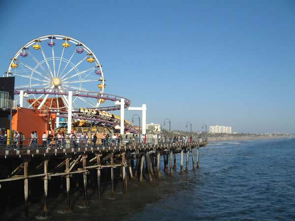
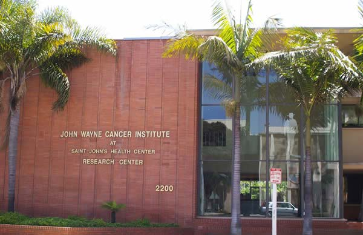
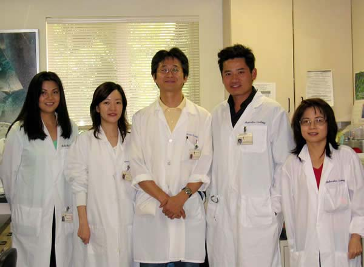
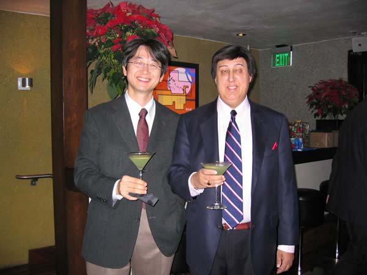
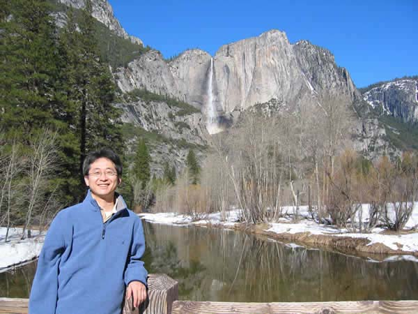
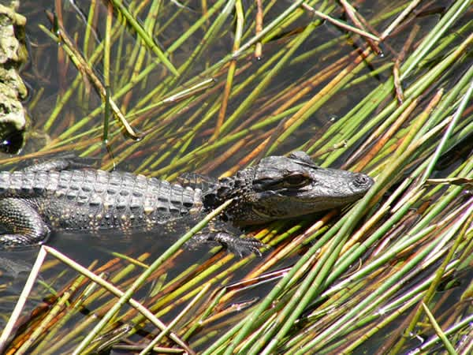
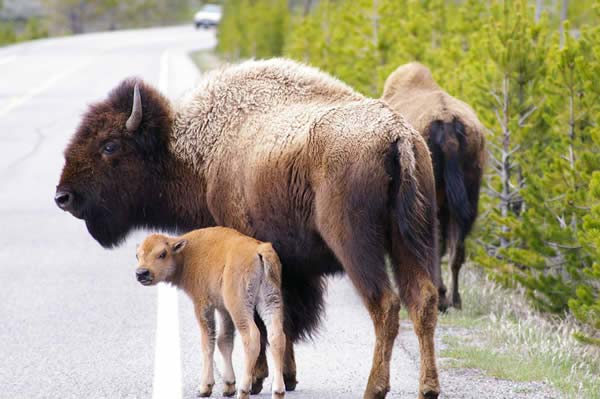

# 米国西海岸留学記

[トップに戻る](../)

> 2003 年 6 月から 2005 年 5 月まで、米国カリフォルニア州サンタモニカの John Wayne Cancer Institute に研究留学したときの報告です。東京大学第一外科の「一外同窓会だより」(2005 年 8 月) に寄稿し、その後、同窓会の Web サイトにも掲載されたものを、Web 版の本文と写真から再現しました。

米国カリフォルニア州サンタモニカのジョンウェイン癌研究所分子腫瘍学研究室におきまして、2003年6月より2005年5月までの２年間、研究留学を経験させて頂きましたので、その報告をさせて頂きたいと思います。

どのような形のご報告をさせて頂くのがよいかと思案いたしましたが、留学に対して否定的な考えをお持ちの若い先生方も多くなっているこの頃ですから、なるだけポジティブな面をお伝えしたいと思います。最近はインターネットの発展もあり、瞬時にして全世界の情報にアクセスすることが可能で、海外からの先端技術や知識を得るための障壁はほとんどありません。英語を学びたいなら気軽に駅前留学だってできますから、いったい何でわざわざ多くの犠牲を払って留学する必要があるのだろうという純粋な疑問が生じるのは当然です。私自身も、大学院を修了して博士号取得した後に、金銭的負担をし、臨床から再び離れることで外科医の技量を損なってまで何のために留学したのか、実際のところ答えはあいまいです。留学先の研究所で一緒に働いた外科フェローたちからも幾度も留学の目的について質問されました。留学すればプロモーションがあるのか、給料が上がるのか、等々です。人間の幅を広げ、人生を楽しむために留学しているんだ、と答えておりましたが、自分でも本当に自分にとって良い選択だったのかどうか最後まではっきりとは答えを得られないでいました。ただ、間違いなく言えるのは、海外での生活は私の見聞を大きく広げてくれたし、多くの違った文化や価値観を持つ人たちと接することができたことはかけがえのない体験であったということです。確かに、研究そのものは日本でもできた内容であり、わざわざ海外でやる必要はなかったと言われれば反論できません。特殊なテクニックを身につけたわけでもなく、実験機器の使用法を覚えた後はむしろ現地で初学者を指導していたような状況でした。ただ、２年間、ボツになったものも含め、さんざん論文の原稿を書いてはネイティブに直して貰っていたので、英語論文を書く訓練はできたと思います。これから留学を考えておられる先生方は特に、助手休職手当を貰いながらの留学が難しくなって金銭的な面でもさらに困難になってくると聞いておりますので、留学によって得られるものと失うもの、よく考えて決定されるのがよいと思います。でも、この留学報告を読んでいただければ、（特に米国西海岸に）きっと行ってみたくなられるのではないかと期待します。

研究所のあるサンタモニカは、ロサンゼルス市に囲まれる海沿いの市で、ビバリーヒルズと同様、広大なロサンゼルス郡の一部をなす行政市です。あまり雨の降らない、明日は晴れだと言っておけばだいたい天気予報は外れないような気候で、カリフォルニアの南に位置しますが、海風が吹くので内陸と違って涼しく、乾燥も適度で、非常に快適に過ごせます。ちなみに、天気予報の感覚が少々違っていまして、予報が「曇り」の場合でも日本で言うところの「晴れ」だったりします。アパートは北向きの部屋の方が南向きの部屋より人気があります。紫外線が少なくて、家具が傷みにくいからだそうです。私は当初そんなことは知らなかったのですが、アパートを借りたとき、部屋がずいぶん明るく感じたので窓は南向きか東向きと思っていたのですが、実際は北向きで、当初は失敗したと思ったのですが、結果オーライでした。

サンタモニカ海岸にある、遊園地のある桟橋「サンタモニカピア」。映画「スティング」で有名です。

では、まずは研究について書かせて頂きます。全体としてみれば、私は恵まれていたし運も良かったと思います。研究室のメンバーは大きくDNAグループ、RNAグループ、蛋白グループに分かれているのですが、大学院での私の研究は主に大腸癌発生における遺伝子変化でありましたので、研究室のボスであるDr. Hoonは私をDNAグループに指定されました。当時、DNAグループにおいては癌における癌抑制遺伝子プロモーター領域のメチル化による転写抑制の研究と、アポトーシス関連遺伝子のアレル不均衡（AI）が主な研究テーマでした。ご存知の通り、DNAはRNAや蛋白に較べ安定ですので、長期保存が容易です。従いまして、前任の篠崎先生が使っておられた臨床サンプルを一部利用させて頂くことができ、新規プロジェクトであったにも関わらず、研究の立ち上げと必要なサンプルの収集がスムースにできました。具体的には、大腸癌、乳癌におけるAPAF1（アポトーシス関連遺伝子のひとつ）のAIの検索です。過去に当ラボにおいて、メラノーマのAI頻度を報告し、予後との有意な関連を示しておりましたので、その研究の対象疾患を広げたわけです。その結果、大腸癌肝転移において高頻度のAIが認められましたので、2004年のAACR (American Association of Cancer Research)にて発表し、Oncogeneに原著論文で報告いたしました。残念ながら予後との関連は明らかではありませんでしたし、AIがあるから転移しやすいのか、転移巣でAIが生じやすいのかも解明できておりませんので、臨床における重要性は不明です。この年のAACRはフロリダのオーランド、ディズニーワールドのそばで開催されました。せっかくなのでマイアミを経由して、海の上をわたるセブンマイルブリッジを渡って、ヘミングウェイが住んでいたキーウエストまでドライブして来ました。そのため学会場にいる時間が限られてしまい、日本から発表に来られた先生方にお会いできず大変失礼いたしました。

働いていたジョンウェイン癌研究所。サンタモニカ通り沿いにあり、街路樹は椰子の木です。窓にジョンウェインのシルエットが見えているのはおわかりでしょうか？

もう一つの研究の柱である遺伝子のメチル化による転写抑制についても、大腸癌、乳癌についていろいろ検索しました。現在、癌抑制遺伝子プロモーター領域のメチル化は癌研究の一つのトピックであり、非常に多くの研究が行われています。そのような中で、何か新しい重要な発見を得て競争に勝つことは非常に大変であろうと考えられました。たとえ実験が上手くいっても、先を越されたら決していいジャーナルには載らなくなってしまうわけですから。従いまして、私は一つの戦略を立てました。癌抑制遺伝子の可能性はあるが未だ確立していない遺伝子についてメチル化の研究を行えば、着目している競争相手が少なく、有利であろうと考えたのです。幸いにして、現在ではヒトゲノム計画の成果として全ての遺伝子配列が公開されております。遺伝子ごとのプロモーターの位置は一部しか明らかではありませんが、コンピューターを使ってかなり正確に予測できるようになってきております。また、これまでに確立された遺伝子の機能は一覧としてNCBIのデータベースにまとめられており、インターネット経由で容易に閲覧可能で、以前のように文献を一から紐とく必要もありませんので、候補とすべき遺伝子の網羅的な検討が可能になっているのです。そのような状況の中で、多くの遺伝子の中から私はID遺伝子ファミリーに注目しました。これらは、様々な転写因子に結合して強力に転写活性を抑制する因子で、発生分化に関わることが知られています。そして分化型は癌の予後に関わる極めて重要な因子です。当時、IDファミリーのID1からID4までの４つの遺伝子のうち、ID4の実際の機能はほとんど分かっておりませんでしたし、結合する転写因子が何かということさえよく分かっていませんでした。そのような背景に着目し、私は原発性大腸癌におけるID4遺伝子のメチル化を詳しく調べることにしました（実際は他に数多くの遺伝子も試していまして、たいがいは日の目を見ない結果に終わっています）。期待に違わずと言うべきか驚いたことにと言うべきか、ID4メチル化の程度は癌の組織分化型と有意に相関しており、また予後とも有意に相関していました（Clinical Cancer Researchに原著論文で報告）。また、直径２ｃｍ以下の乳癌における検討では、最も重要な予後規定因子である腋下リンパ節転移と高度に相関していたのです（2005年AACRにて発表、Oncogeneに原著論文で報告）。この相関はまさに驚くべき有意確率を示しておりましたので、臨床検体を対象にした研究ではありましたが、Oncogeneを報告先に選びました。ちなみに、2005年のAACRはロサンゼルス近郊のアナハイムで開催されましたが、ご存知の通りそこはディスニーランドのある場所です。2004年に続いて、AACRは再びリゾート地志向でした。AACRは純粋な研究者が多いせいか、ラフな格好の発表者が多いので気楽です。来年はワシントンなのでリゾート地ではありませんが、ぜひまた参加したいと思っています。そんな結果に気をよくした私は、この遺伝子の機能を解明すべく、大腸癌培養細胞における遺伝子導入による強制発現とsiRNAによる発現抑制のプロジェクトを開始いたしたのでした。残念ながら、私の基礎研究の経験不足とID4そのものの複雑さから実験は進まず、結果を得られないまま時が流れてゆきました。その後、Nature GeneticsにID4が新規癌抑制遺伝子である旨の報告がなされ、先を越された形になってしまいました。しかしながら、その投稿時期は私が研究を始めた直後あたりであって、たとえ実験が非常に上手くいっていても先を越されて逆に悔しい思いをするだけであったと思われ、逆に、自分の計画していた研究と似た内容のものが高く評価されたことで、悔しいんだけれどもなんだか救われたような不思議な気分であったのを思い出します。

研究室にて。妻（左から２番目）も秘書として働いていました。

当研究所と併設の病院であるセントジョーンズ病院は、今やカリフォルニア州知事になってしまったシュワルツネッガーが心臓手術を受けたことでも有名ですが、悪性黒色腫瘍と乳癌の治療で有名です。センチネルリンパ節生検のパイオニアであり、症例数は極めて多く、特に悪性黒色腫瘍のメッカと呼ばれています。オゾン層の破壊とそれによる紫外線の増加、そして日焼けを物ともしない人々の気風から、カリフォルニアにおける悪性黒色腫瘍発生は今後増加の一途をたどると思われますので、さらにこの研究所と病院の重要性は増すものと思われます。しかし、残念ながら大腸癌症例はそれほど多くなく、胃癌症例に至っては数えるほどしかありませんので、残念ながらこれら消化器癌を対象とした研究は標本の入手が限られておりました。そこで、オランダの癌研究グループの行った大規模な前向き臨床研究である、胃癌手術の郭清をランダムにD1とD2に分けてその予後と合併症を比較して適切な手術方針を決定するという、いわゆる胃癌D1-D2 studyの標本を対象とした共同研究プロジェクトと、直腸癌手術でTME (total mesorectal excision) を行う場合と行わない場合の予後や局所再発率などを比較して適切な手術方針を決定するという、いわゆる直腸癌TME studyの標本を対象とした共同研究プロジェクトを本格的に始動いたしました。当ラボにてライデン大学の研究生を受け入れて遺伝子研究を指導し、ヨーロッパから標本を運んで遺伝子変化の検索と予後やリンパ節転移などの予後規定因子との関連について調べるというプロジェクトです。前向き研究で、手術内容がきちんとコントロールされ、かつ術後１０年間完璧にフォローアップされた癌患者の集団は極めて貴重であり、信頼性の高いデータが得られると考えられ、それらにアクセスできる可能性は、私にとってまたとないチャンスでした。ところがやはり貴重な標本だけあってなかなか一筋縄ではいきません。我々はまず、ライデン大学側からの課題に対して評価を得なくてはなりませんでした。彼らの持つ他のもっと小さなスケールの臨床研究の対象患者の標本に対に対し、１枚のパラフィン切片からどこまで解析できるのか示せ、と言うのです。一般的に、メチル化の研究は通常のDNAの研究と較べて多少難易度が高いため、ホルマリン固定のパラフィンブロックからの切片では再現性が低く、なかなか臨床病理所見との関連性を示すのが困難な場合が多いのです。しかし、もともと私は大学院生時代にはパラフィンブロックの切片からのDNA解析を行っておりましたし、前述のID4遺伝子の研究で培った技術と、新たに開発したメチル化研究用のコントロール（BBRCで原著報告）をもって、非常に再現性の高い解析を行うことができました。その技術を若い研究生に指導し、結果として、小さな母集団の標本であったにもかかわらず、遺伝子メチル化マーカーと予後の相関を示すことができたのです。その実験が終わった段階で、その研究生と共にライデン大学まで私自身が出向いて研究内容とその結果、これから計画している研究計画、他の施設では不可能な技術などについて、ボスであるファンデヴェルデ教授ほか外科と病理のスタッフらの前でプレゼンテーションを行いました。それは渡米から１年半が経った昨年の年末のことでした。その出張のおかげで、幸運にもヨーロッパのクリスマスがどんなものか体験できました。予想に違わず厳しい寒さでしたが、運良く好天に恵まれ、１２月中はほとんど雨が降り続くと言われるオランダでさえも快晴が続き、誰からもおまえはラッキーだ、と言われました。訪れる先々の都市の広場にはクリスマスツリーが飾られ、屋台で伝統的な食べ物を楽しむことができました。ライデン大学外科の医師や看護師達のクリスマスランチパーティーに招かれました。数種類のパンと熟成期間と塩分の違う数種類のチーズが並んでいて、それで好きなサンドイッチを自分で作る他に、伝統的なコロッケがあったり、クリスマスの時期だけに食べるという菓子パンがあったりして、オランダならではのスタイルを楽しむことができました。クリスマスディナーはアムステルダムのレストランでとりましたが、予約が大変でした。というのは、日本のようにレストランがどこも予約でいっぱいになっていたからではありません。ヨーロッパの人たちはみんな家で家族と過ごすので、開いているレストランを探すこと自体が大変だったのです。

そのような楽しいけれども少々荷の重い出張の結果、オランダ癌グループの持つ貴重な標本を使用させて頂く許可を得まして、当地にてマイクロトームをせっせと回して数百症例分のパラフィン切片を作成し、臨床情報と共にサンタモニカまで持ち帰ったのです。今のところ解析は終了しておりませんで、私がいる間には共同研究は完成しなかったのですが、結果は出つつありますので、近々公表されることと思います。何より、オランダ人の研究生を一から指導し、貴重なサンプルを使ってプロジェクトを進めさせて頂いた経験は非常に貴重なものでした。また、その研究生とは個人的にも親しくさせて頂きましたし、人を指導することは自分の英語力の向上にとても有用であったと思っています。

当研究室のもう一つの大きな柱として、担癌患者における血清中の遊離DNAの測定と解析があります。意外と知られていないし、人によっては信じて頂けないのですが、担癌患者の血清中には、癌細胞から放出されたDNAがたくさん漂っています（本当です）。従って、遊離DNAの絶対量を測定したり、そのうちの癌抑制遺伝子のメチル化やAIを検出したりすることで、癌の進行度や予後判定に役立てることができます。私は大学院での研究中に、大腸癌術中門脈血の遊離癌細胞由来mRNAのPCRによる検出を試みた経験があることもあり、渡米前よりこの遊離DNAに関しても非常に興味を持っておりました。ところが、このような血液を利用する新たな臨床研究を申請することは言葉の壁もあって実際には敷居が高いものです。他の実験で忙しかったこともあり、なかなかプロジェクトを立ち上げられずにいたのですが、そのような折り、外科フェローの一人が共同研究しようと私に申し入れてきました。膵癌患者の術前の血清を集めているのだが、これを使った研究で何かいいアイデアがあればと言うのです。これ幸いと、それまで構想を温めていました遊離DNAのある特殊な性質に基づく新しい癌の検出方法を試してみましたところ、満足のいく結果が得られました。改良の結果、わずか１滴の血清から進行癌患者の判別がかなりの確率で可能となりました。さらに対象を拡大してその他の悪性腫瘍にも応用可能であることが分かりました。さらに、リンパ節転移の有無に極めて高い相関を示すことも明らかになりましたので、今後論文として発表させて頂く予定にしています。

研究室のクリスマスパーティーにてDr. Hoonと。

私が当研究室のボスであるDr. Hoonに対して素晴らしいと感じることは、研究者の一人一人に対してその適性を判断し（もしくは周囲の人間に評価を仰ぎ）、ある者にははっきりしたテーマと細かい指示を与え、ある者にはおおまかな目標を与えるのみで自由に研究をさせるという点です。私は後者に属しましたが、その理由はたぶんあまり画一的な実験が得意でなく、全く同じ操作をきちんと繰り返すことができない性格であることを見抜かれていたためと思います。さらに自分からもそのような実験はやりたくないと言ったことも大きな理由です。ここをもうちょっとこうすれば良くなるのに、とついつい実験プロトコルを少しずつ改良（改悪？）してしまうのが私の悪い癖なのです。従いまして、たとえば多施設合同研究における検体処理を任されることはありませんでした。なぜなら、そのような研究には（効率の悪さに目をつむり、無意味な操作手順さえも手抜きすることなく）毎日全く同じように実験を繰り返す根気強さが必要とされるからです。このようなプロジェクトから外れることは、私自身望んだことではありますが、ある意味では失敗だったかもしれません。なぜなら、そのような多施設合同研究は、得られた結果をまとめたとき、その論文が高く評価されることが初めからほぼ約束されているからです。しかし、それを得られなかった反面、私は自分のアイデアを存分に生かし、自分の主導の元に好きな研究を進めることができました。Dr. Hoonのご高配により、オランダ人研究生の他、UCLAの学生ボランティアを一人配置して頂き、さらに終盤は専属のテクニシャンを一人雇って頂いて、非常に効率よく、また楽しく研究を進めることができました。また、比較的予算が潤沢であったのも運が良かったと言えます。彼は、私がいろいろなことに手を出してその多くが徒労と無駄に終わっているのを知りつつも、私が購入を要求した物品や試薬が却下されたことは一度もありませんでした。その点、自分は非常に恵まれていたと思いますし、本当に心から感謝しております。

話はそれますが、膵臓癌患者の血清の研究を進める上で、非常に印象深かったことがあります。それは、対象患者を増やしたくてUCLAの外科レジデントに採血を依頼しようとしたときの話です。術前の血液を集めたいので、入院したら手術までに承諾書を取って採血をして欲しい旨お願いしました。そうしますと、手術の朝は忙しくてとても無理だというのです。別に当日じゃなくても前日でもいつでもいいんだけど、と言いますと、なに言ってるんだ、膵頭十二指腸切除の患者は術当日入院だ、だそうです。やはりアメリカは進んでいるといいますか、どうかしているといいますか、驚きでした。確かに、直前の食事制限さえ守ってくれれば、前泊する必要はないんですね。医療費がべらぼうに高いですから、１日でも入院日数が少ない方がいいのです。私の留学先は病院と密接にリンクした研究所であったため、多くの臨床医と交流を持つことができ、アメリカにおいて医療行為は経済活動であるということを肌で感じることができました。前述のテクニシャンが心窩部不快感でバリウムを飲んだのですが、$2000払ったと言っていました。彼女は日本人の血を引いているのに日本に来たことが無く、一度行ってみたいと言っていたので、次に検査を受けるときは日本においでと言っておきました。飛行機代出しても日本の方がまだ安いですからね。彼女も医師を目指して準備中なのですが、自分はボランティアで手伝っている貧困者層を対象とした無料診療所で将来医師として働きたいけれども、やっぱりお金持ちにもなりたいからみんなのような普通の医者にもなりたいし、と悩んでいました。是非とも、その純粋な心のまま立派な医師になって欲しいと思います。

アメリカ留学の２年間は楽しいものでした。ストレスから解放されて、南カリフォルニアの青空の下、ポケベルも持たず、旅行したければ気兼ねなく有給休暇を取り、まるで夢のような日々でした。浜辺でローラーブレードに挑戦し、ゴルフを楽しみました。おおっぴらではありませんが、午前中ラウンドしてその後ラボで実験した日もあります。ビバリーヒルズやハリウッドを散策し、ファーマーズマーケットで新鮮な野菜や果物を手に入れ、コンサートやミュージカル、ジャズフェスティバルなどを楽しみました。日本人選手が活躍してくれたおかげで、大リーグも存分楽しめました。イチロー、松井秀、長谷川、中村の試合を観戦しましたが、タイミングを逃して野茂を見そびれたのは少々心残りです。また、バスケットボールを観戦し（ステイプルズセンターでレイカーズ）、ロングビーチではトヨタグランプリを観戦しました。凝縮してぎっちり楽しんだ、という感じです。

また、いろいろな国の料理を楽しめるのもロサンゼルスの特徴です。特に、コリアンタウンとベトナミーズタウンは米国で最も大きいそうです。私が気に入っていたのは、韓国料理ではスンドゥブという辛い豆腐鍋です。肉や蝦、牡蛎などでだしが取ってあり、ぐつぐつ煮える鉄鍋で出されます。この料理は日本では馴染みは薄いのですが、この専門店がたくさんあり、非常にポピュラーです。味は店によってまちまちなので、何軒も廻っておいしい店を見つけ、そこに通いました。帰国するにあたって、これが食べられなくなるのが非常に残念で後ろ髪を引かれる思いでした。また、焼き肉も日本とは違っていて楽しめました。また、スーパーでは食材が非常に安く手に入ります。むしろ品質のいいものが日本食スーパーと較べて１０分の１くらいで手に入ることがあります。たとえば、ネギが20把くらいで$1だったり片手でもてない巨大な大根が50c.だったりします。生牡蠣のキムチは絶品でした。また、ベトナム料理も大好物で、何度も片道80Kmドライブしてベトナミーズタウンに足を運びました。最初はどの店が美味しいか分からないので、ラボで働いているベトナム人と一緒に行って教えてもらったりしたものです。ライスヌードルであるフォーは日本でも最近は特にダイエット食としても人気が高いものですが、そのお店はスープの深みが全然違って格別でした。フランスの植民地支配の歴史のため、食文化レベルは高く、たとえばサンドイッチにはフランスパンが使われます。でも中身には香草などが使われて、アジアの味です。お気に入りだった店は英語が通じないのが唯一の難点でしたが、その美味いサンドイッチを食べるため必死で身振りを交えて伝えて買っておりました。

残念なのは、そのようなロサンゼルスの美味しい店を知ったのが留学も後半に入ってからだったということです。前半はほとんど試行錯誤で外してばかりいたような気がします。渡米後しばらくは、アメリカの食べ物は味が濃くて甘すぎたりして美味くない、ガイドブックにはロサンゼルスはグルメの都市と書いてあるけれどとてもそうは思えない、と考えていました。でも結局それは美味しい店を知らなかっただけのことで、たしかにグルメの都市だと気づいたときには残りは限られた時間になっていました。実は、渡米後半年ほどたった頃に、実験の先が見えず少々やる気を失っていた時期もあったのですが、おかしなものでラボで遅くまで実験するわけでもなく時間はあったはずなのに、遊びの方もあまり発展的には動けませんでした。このような時期があることはある程度仕方がないことかもしれませんが、今から考えるともったいないことをしたと思います。これから留学をなさる予定の皆さん、ぜひ有意義に過ごしてください。あっという間に終わってしまいますよ。

冬のヨセミテ国立公園です。川岸に雪の積もるマーセド川の向こうには、落差700mのヨセミテ滝が見えています。

アメリカ西海岸にはいろいろ楽しみがありましたが、なんと言っても国立公園が私にとっての最大の楽しみだったと言えましょう。カリフォルニアにはたくさんの国立公園がありますし、それ以外も多くの国立公園が西海岸側にあります。従いまして、ロサンゼルスは国立公園巡礼には最適な場所だと思います。もちろん、中部や東海岸にも何カ所か訪れました。私が２年間に訪れた国立公園はといいますと、グランドキャニオン、デスバレー、セコイア、エバーグレーズ、ヨセミテ、ロッキーマウンテン、マウントレーニエ、ザイオン、ブライスキャニオン、キャピトルリーフ、アーチーズ、キャニオンランズ、化石の森、チャンネル諸島、ジョシュアツリー、カールスバッド洞窟群、イエローストーン、グランドティトンです。さらに、ホワイトサンズ、キャニオン・デ・シェイ国定公園に行きました。また、西部劇で有名なモニュメントバレーやゴブリンバレー州立公園にも訪れました。どれもこれも個性的で、他では見られない自然を楽しませてくれました。いつでも行けると思うからでしょうか、意外と現地のアメリカ人は国立公園など行かないもので、あれだけ有名なヨセミテやグランドキャニオンに行ったことのない人はたくさんいます。砂漠系の公園は概してアメリカ人には人気がないようです。ですから僕の国立公園巡りを聞くと、研究室のみんなは、誰よりもアメリカを体験していると言って驚きます。

これらの中で、私がもっとも気に入った場所はヨセミテです。あの場所の美しさは神々しくさえあります。雪解けで滝の水量がもっとも増すのは５月下旬、この時期の週末は観光客であふれます。バレー内のロッジは１年前から予約できるのですが、７月に翌年の５月下旬の週末を予約しようとしますと、すでに満室で驚きました。そのため平日にかけて部屋を押さえてその日を１０ヶ月間楽しみに待ちました。７００ｍという、世界第２位の落差を持つヨセミテ滝からは期待通り豊富な水がまるで空中に踊り出すかのごとく断崖からほとばしり、轟音と共に滝壺へ落ちてきておりました。まさに絵葉書の写真そのもの、もしかするともっと水量は多かったのではないでしょうか、まさに自然の雄大さを感じさせられました。マーセド川上流にはバーナル滝があり、その滝壺の横のトレイルをずぶぬれになりながら登れば足下にその滝を眺めることができました。本当に素晴らしい国立公園でした。その後、冬の雪の季節にも再び訪れましたが、朝もやのかかる雪原から見上げる山々と、朝日にきらめく虹のかかったヨセミテ滝はまさに心の洗われる美しい世界でした。言葉では表せない感動がそこにはありました。

フロリダのエバーグレーズ国立公園で見つけた野生のアリゲーターの赤ちゃんです。

その次を挙げるとすれば６月に訪れたシアトル近郊のマウントレーニエでしょうか。氷河を歩いた経験も初めてだったのですが、そのすぐ周囲は咲き乱れる高山植物と鮮やかな新緑が広がり、ライチョウの雛が親鳥に導かれて飛ぶ練習をしていたりして、いたく感動しました。国立公園は道路などがよく整備されており、車でドライブするだけでも美しい景色を眺めることはできますが、トレイルを歩いて初めて目の当たりにできる美しい景色の感動は他では得難いものがあります。日本からのツアーなどですと、バスで廻ってはい食事、お土産買ったらさあ次へ、になってしまいがちですが、その点、留学中ならゆったりと計画してじっくり見られますので、魅力を満喫できます。キャンプなどするともっと楽しめたのかもしれませんが、残念ながらキャンプは未経験のまま終わってしまいました。

学問と関係のない話ばっかりで恐縮なのですが、カリフォルニアはワインの産地でもあり、そちらもずいぶん楽しませて頂きましたので一言紹介させて頂きます。サンフランシスコの北に位置するナパとソノマがもっとも有名な産地で、私も２度行って有名どころのワイナリーを訪問いたしました。一般公開していないワイナリーもありますので、つてを頼って個人的にコンタクトを取ったりしていろいろなワインをテイスティングさせて頂きました。印象的だったのは非常に洗練された深い味わいのカベルネを出しておりますHARTWELLというワイナリーです。葡萄畑の丘の中腹に掘られた洞窟の中に貯蔵庫があり、その奥に蝋燭明かりの丸い部屋があってそこがテイスティングルームになっています。運良く、たまたま訪問していた他のワイナリーのオーナーと同席になったおかげで、普通はテイスティングに出さない高級品まで次々出てきて堪能させて頂きました。このエリアは、ワインの作り手の多くがヨーロッパから来ており、食文化のレベルが高いので、美味しいレストランもたくさんあります。他にも、最近、Sidewayという映画にもなりましたが、サンタバーバラにも極上のワイナリーがあったりしますので、カリフォルニアはワイン好きにはたまらないエリアです。アメリカに行く前はカリフォルニアワインのことなどあまり知りませんでしたが、すっかりはまってしまいました。

イエローストーン国立公園にて。道を渡ろうとする野生のバイソンの親子です。

私が留学している間、アメリカはまさに戦争の当事者でした。しかし、テレビのニュース以外ではそれを感じることはほとんどありませんでした。唯一の例外は、サンタモニカやサンタバーバラの砂浜に毎週末立てられる白い十字架です。それまでに戦争で亡くなったアメリカ兵士の数だけ立てますので、次第に数が増えてゆき、留学中盤でその数は１０００を越え、いまだに増え続けております。その脇の張り紙には、もしこの戦争で亡くなったイラク人の数だけ十字架を立てるとしたら、この砂浜は十字架で埋め尽くされるだろう、と記されていました。気づいたことは、メディアは決して戦争の犠牲となったアメリカ兵の死体をブラウン管に写さないことです。政権に対する反対意識を押さえるため、意図的に報道が統制されていると言われています。言葉の壁もあってあまり政治的なことを議論することは少なかったのですが、少なくともカリフォルニアで出会ったインテリの人たちは揃って反ブッシュであって、大統領選での彼の勝利は不思議に思えました。しかし、アメリカ合衆国とはその名のとおり、考え方の異なる州の寄せ集まりであって、州によって考え方が大きく異なるそうです。場所によっては非常に排他的であったりするそうです。その点一つとっても、私の留学先がカリフォルニアであって良かったと思います。

とりとめのないまま長くなってしまいました。とにかく、２年間の留学は短いものでしたが、研究の面でも、遊びの面でも、本当に充実した素晴らしいものでした。願わくは、研究で得られたいくつかの成果のうち、一つでも何らかの形で臨床に応用され、医学の発展のささやかな一助になればと願っております。最後になりましたが、私の留学をお許しくださいました名川教授、渡邉助教授には心より感謝しております。本当にありがとうございました。また、留学前に相談に乗って頂いた諸先生方、助手を休職することでご迷惑をおかけしました諸先生方、そして、英語ができないと躊躇していた私を後押ししてくれた妻にも感謝しています。この場をお借りしてお礼申し上げます。帰国後は東京都老人医療センター外科に勤務となりましたので、また精一杯臨床に励んでゆきたいと思います。今後ともご指導のほど宜しくお願い申し上げます。

2005 年 7 月 4 日 記

---

[トップに戻る](../)
